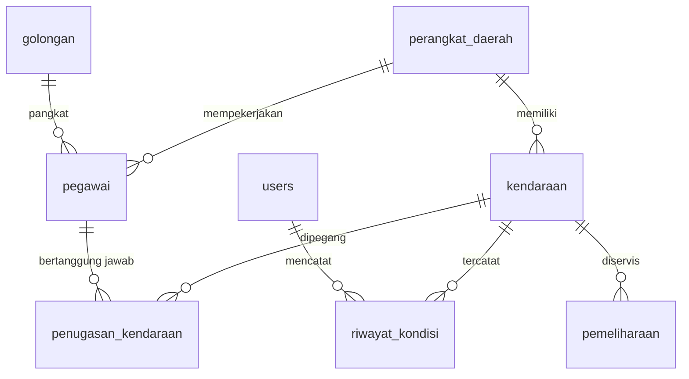

# Rencana Implementasi — SIM-KDO

Sistem Informasi Manajemen Kendaraan Dinas Operasional (KDO) milik Perangkat Daerah, sebagai bagian dari pengelolaan Barang Milik Daerah (BMD).

Dokumen ini adalah acuan kerja utama. Setiap fase diakhiri commit dan bisa diverifikasi secara terpisah.

---

## 1. Target Penilaian → Keputusan Desain

| Komponen penilaian | Bobot | Cara dipenuhi |
|---|---|---|
| Fungsionalitas & relasi entitas | 15 | 3 entitas wajib + entitas pendukung, FK nyata, aturan bisnis (penanggung jawab aktif, PD yang sama) |
| Kualitas kode & struktur | 20 | Monorepo `backend/` + `frontend/`, layered architecture Go (handler → service → repository), TypeScript |
| Git | 10 | Commit kecil per langkah, Conventional Commits, push tiap akhir fase |
| Dokumentasi | 5 | README (setup Docker + manual), AGENTS.md, Swagger, docs/ERD, docs/ai |
| Track FE / BE | 20 | UI lengkap (list, detail, form, dashboard, trash) + REST API yang tervalidasi dan terdokumentasi |
| Bonus fullstack | 10 | SPA React memakai REST API Go, jalan bareng lewat satu `docker compose up` |
| Bonus RDBMS + dump | 10 | PostgreSQL: FK, CHECK, partial unique index, migrasi SQL eksplisit, dump `database/sim_kdo.sql` |
| Bonus fitur/data riil | 5 | Penugasan, pemeliharaan, riwayat kondisi, pengingat pajak/STNK, nama PD DKI riil, golongan PNS sesuai aturan |

## 2. Stack

| Lapisan | Pilihan | Catatan |
|---|---|---|
| Bahasa BE | **Go 1.25** | sudah terpasang lokal; image Docker `golang:1.25-alpine` |
| HTTP | Gin | binding + validator (go-playground/validator) |
| ORM | GORM + driver pgx | `gorm.DeletedAt` untuk soft delete, `Unscoped()` untuk trash/force. **Tanpa AutoMigrate** |
| Migrasi | golang-migrate, file SQL di-embed | DDL ditulis manual sebagai bukti desain RDBMS |
| Auth | JWT (golang-jwt/jwt/v5) + bcrypt | Bearer token, masa berlaku 8 jam |
| Dok API | swaggo/swag + gin-swagger | UI di `/swagger/index.html`, file `swagger.json/yaml` → bisa di-import ke Postman |
| Test BE | `testing` + testify + httptest | test integrasi memakai DB `sim_kdo_test` (dilewati jika `TEST_DATABASE_URL` kosong) |
| DB | **PostgreSQL 17** (Docker) | |
| Frontend | **Template [shadcn-admin](https://github.com/satnaing/shadcn-admin)** (MIT) | Vite + React + TypeScript + Tailwind + shadcn/ui + TanStack Router + TanStack Query |
| Form FE | react-hook-form + zod | sudah dipakai template |
| Grafik | Recharts | |
| Runtime | Docker Desktop + Docker Compose | `db`, `api`, `web` (nginx), `adminer` (opsional) |

## 3. Struktur Repo

```
sim-kdo/
├── backend/
│   ├── cmd/simkdo/main.go        # subcommand: serve | migrate up/down | seed
│   ├── internal/
│   │   ├── config/               # baca env
│   │   ├── database/             # koneksi GORM + runner migrasi
│   │   ├── model/                # struct GORM
│   │   ├── dto/                  # request & response struct + tag validasi
│   │   ├── repository/           # query DB (filter, sort, paginate, trash)
│   │   ├── service/              # aturan bisnis + transaksi
│   │   ├── handler/              # HTTP handler Gin (tipis)
│   │   ├── middleware/           # auth JWT, role, CORS, rate limit, recovery, request log
│   │   ├── httpx/                # envelope respons, mapping error (validasi, pg 23505/23503 → 409)
│   │   ├── router/               # registrasi route /api/v1
│   │   └── seed/                 # data seed riil
│   ├── migrations/               # 000001_*.up.sql / .down.sql
│   ├── docs/                     # hasil swag (jangan diedit manual)
│   ├── Dockerfile                # multi-stage → image kecil
│   └── .env.example
├── frontend/                     # shadcn-admin yang sudah dibersihkan
│   ├── Dockerfile                # build → nginx
│   ├── nginx.conf                # SPA fallback + proxy /api → api:8080
│   └── .env.example
├── database/
│   └── sim_kdo.sql               # pg_dump (skema + data)
├── docs/
│   ├── PLAN.md  ERD.md  API.md
│   ├── api/                      # swagger.yaml + postman_collection.json
│   ├── screenshots/{fe,api}/
│   └── ai/PROMPTS.md
├── docker-compose.yml
├── .env.example
├── AGENTS.md
├── README.md
└── .gitignore                    # WAJIB mengabaikan soal.text (berisi kredensial)
```

## 4. Desain Database (ERD)



Semua PK `BIGSERIAL`, semua waktu `TIMESTAMPTZ`, enum ditulis sebagai `VARCHAR` + `CHECK` (lebih mudah dikembangkan daripada tipe ENUM Postgres).

**perangkat_daerah**
`id`, `kode` (mis. `DISDIK`), `nama`, `singkatan`, `jenis` CHECK (dinas, badan, kantor, satuan, inspektorat, biro, lainnya), `alamat`, `telepon`, `email`, `created_at`, `updated_at`, `deleted_at`

**golongan** (tabel referensi, hanya di-seed, endpoint read-only)
`id`, `kode` UNIQUE (`I/a` … `IV/e`), `pangkat` (mis. `Penata Muda`), `ruang`, `tingkat` (1–4)

**pegawai**
`id`, `nip` CHAR(18) CHECK `nip ~ '^[0-9]{18}$'`, `nama`, `jabatan`, `golongan_id` FK, `perangkat_daerah_id` FK, `jenis_kelamin` CHECK (L,P), `email`, `no_hp`, timestamps, `deleted_at`

**kendaraan**
`id`, `nomor_polisi` (uppercase, format `B 1234 ABC`), `kode_barang` (kode BMD, mis. `1.3.2.02.01.01.003`), `nomor_register`, `merk`, `tipe`, `jenis` CHECK (roda_2, roda_4, roda_6_lebih), `tahun_produksi` SMALLINT CHECK (1980..2100), `warna`, `nomor_rangka`, `nomor_mesin`, `bahan_bakar` CHECK (bensin, solar, listrik, hybrid), `isi_silinder` INT, `kondisi` CHECK (baik, rusak_ringan, rusak_berat), `tanggal_perolehan` DATE, `nilai_perolehan` NUMERIC(15,2), `masa_berlaku_stnk` DATE, `jatuh_tempo_pajak` DATE, `perangkat_daerah_id` FK, `keterangan`, timestamps, `deleted_at`

**penugasan_kendaraan** (penanggung jawab penggunaan, ada riwayatnya)
`id`, `kendaraan_id` FK, `pegawai_id` FK, `nomor_bast` (Berita Acara Serah Terima), `tanggal_mulai` DATE, `tanggal_selesai` DATE NULL (null = masih aktif) CHECK `tanggal_selesai >= tanggal_mulai`, `keterangan`, timestamps, `deleted_at`

**riwayat_kondisi** (dicatat oleh service saat `kendaraan.kondisi` berubah, dalam transaksi yang sama)
`id`, `kendaraan_id` FK, `kondisi_lama` NULL, `kondisi_baru`, `user_id` FK NULL, `catatan`, `created_at`

**pemeliharaan**
`id`, `kendaraan_id` FK, `tanggal`, `jenis` CHECK (servis_rutin, perbaikan, penggantian_suku_cadang, lainnya), `bengkel`, `kilometer` INT, `biaya` NUMERIC(15,2), `uraian`, timestamps, `deleted_at`

**users**
`id`, `name`, `email` UNIQUE, `password_hash`, `role` CHECK (admin, operator), timestamps

### Index dan constraint khas PostgreSQL
- **Partial unique index** agar unik hanya di antara data yang tidak terhapus:
  `UNIQUE (nomor_polisi) WHERE deleted_at IS NULL`, begitu pula untuk `pegawai.nip`, `perangkat_daerah.kode`, `perangkat_daerah.nama`, `kendaraan.nomor_rangka`, `kendaraan.nomor_mesin`.
- **Satu penugasan aktif per kendaraan dijamin di level DB**:
  `CREATE UNIQUE INDEX uq_penugasan_aktif ON penugasan_kendaraan (kendaraan_id) WHERE tanggal_selesai IS NULL AND deleted_at IS NULL;`
- Index tambahan: FK, `kendaraan(kondisi)`, `kendaraan(jatuh_tempo_pajak)`, `pegawai(nama)`.

### Aturan Integritas dan Bisnis
1. Satu kendaraan hanya punya **satu penugasan aktif**. Service mengecek lebih dulu agar pesannya ramah; index di DB menjadi pengaman terakhir.
2. Pegawai penanggung jawab harus berasal dari **PD yang sama** dengan pemilik kendaraan.
3. Kendaraan `rusak_berat` tidak bisa ditugaskan.
4. Soft delete ditolak (HTTP 409) jika:
   - PD masih punya pegawai/kendaraan aktif,
   - kendaraan masih punya penugasan aktif,
   - pegawai masih memegang kendaraan.
5. Force delete (destroy) hanya untuk data yang **sudah ada di trash** dan hanya oleh **admin**.
   - FK ke `perangkat_daerah` dan `golongan`: `ON DELETE RESTRICT`.
   - Kendaraan di-destroy → riwayat_kondisi, pemeliharaan, penugasan ikut terhapus (`ON DELETE CASCADE`).
   - `penugasan_kendaraan.pegawai_id`: `ON DELETE RESTRICT`, jadi pegawai yang punya riwayat penugasan tidak bisa di-destroy (409, demi jejak audit).
6. Restore yang bentrok dengan partial unique index (mis. nopol yang sama sudah dipakai data aktif) → 409 dengan pesan jelas.
7. Error Postgres dipetakan di `httpx`: `23505` unique → 409, `23503` FK → 409, `23514` check → 422.

## 5. Desain REST API

Base URL: `/api/v1`. Semua endpoint selain `/auth/login` dan `/health` butuh `Authorization: Bearer <token>`.

### Format respons seragam
```json
{ "success": true, "message": "Data kendaraan berhasil disimpan", "data": { }, "meta": { "page": 1, "per_page": 10, "total": 80, "total_pages": 8 } }
```
Error:
```json
{ "success": false, "message": "Data tidak valid", "errors": { "nomor_polisi": "Nomor polisi sudah terdaftar" } }
```
Kode status: 200, 201, 400 (JSON rusak), 401, 403, 404, 409, 422, 429, 500 (tanpa detail internal).
Pesan error validasi ditulis dalam Bahasa Indonesia dan memakai nama field JSON (snake_case).

### Endpoint

| Method | Path | Keterangan |
|---|---|---|
| GET | `/health` | cek API + koneksi DB |
| POST | `/auth/login` | rate limit 5/menit per IP |
| GET | `/auth/me` | |
| GET | `/dashboard` | ringkasan statistik |
| GET | `/golongan` | referensi |
| GET/POST | `/perangkat-daerah` | list (search, sort, paginate) / create |
| GET/PUT/DELETE | `/perangkat-daerah/:id` | detail (+ jumlah pegawai/kendaraan) / update / soft delete |
| GET | `/perangkat-daerah/trash` | daftar terhapus |
| PATCH | `/perangkat-daerah/:id/restore` | restore |
| DELETE | `/perangkat-daerah/:id/force` | destroy permanen (admin) |
| … | `/pegawai`, `/kendaraan`, `/pemeliharaan`, `/penugasan` | pola yang sama persis dengan di atas |
| PATCH | `/penugasan/:id/selesai` | akhiri penugasan (isi `tanggal_selesai`) |
| GET | `/kendaraan/:id/riwayat-kondisi` | riwayat perubahan kondisi |
| GET | `/kendaraan/export` | unduh CSV sesuai filter yang aktif |
| GET | `/options/perangkat-daerah`, `/options/pegawai?perangkat_daerah_id=`, `/options/kendaraan` | daftar ringkas untuk dropdown |

Catatan Gin: daftarkan route statis (`/trash`, `/export`) **sebelum** `/:id`, atau pastikan tidak bentrok.

### Query list
`search`, `sort` (mis. `-tahun_produksi`, hanya kolom yang ada di whitelist), `page`, `per_page` (maks 100), plus filter:
- kendaraan: `perangkat_daerah_id`, `kondisi`, `jenis`, `tahun_min`, `tahun_max`, `status=digunakan|tersedia`, `pajak_jatuh_tempo=30`
- pegawai: `perangkat_daerah_id`, `golongan_id`
- penugasan: `status=aktif|selesai`, `kendaraan_id`, `pegawai_id`

### Keamanan dasar
JWT dengan secret dari env, bcrypt, rate limit login, middleware role (admin vs operator), whitelist kolom sort (cegah SQL injection), batas ukuran body, CORS dibatasi ke origin FE, tidak ada secret di repo (`.env` di-ignore, sediakan `.env.example`), container API berjalan sebagai user non-root.

## 6. Desain Frontend (berbasis shadcn-admin)

**Cara mengimpor template:** salin tanpa riwayat git (`npx degit satnaing/shadcn-admin frontend`), commit apa adanya dengan pesan jujur (`chore(fe): import template shadcn-admin (MIT)`), lalu commit terpisah untuk membersihkannya. Hapus halaman demo yang tidak relevan (tasks, chats, apps, Clerk, dsb.), pertahankan layout sidebar, theme switch, komponen data table, dan halaman error. Pertahankan LICENSE/kredit template di README.

Halaman (label Bahasa Indonesia, responsif):
1. **Login** (ubah dari halaman sign-in template, tersambung ke `/auth/login`)
2. **Dashboard**: kartu KPI (total KDO, baik, rusak ringan, rusak berat, sedang digunakan, belum ada penanggung jawab), donut kondisi, bar KDO per PD (top 10), tabel pajak/STNK jatuh tempo ≤ 30 hari dan yang sudah lewat, daftar penugasan terbaru
3. **Kendaraan**: list (server-side search, filter, sort, pagination, badge kondisi, ekspor CSV), detail (data lengkap, penanggung jawab aktif, riwayat penugasan, riwayat kondisi, riwayat pemeliharaan), form tambah/ubah, tab/halaman trash
4. **Pegawai**: list, detail (kendaraan yang sedang dan pernah dipegang), form, trash
5. **Perangkat Daerah**: list, detail (statistik, daftar pegawai dan kendaraan), form, trash
6. **Penugasan**: list (filter aktif/selesai), form tugaskan (dropdown pegawai otomatis difilter sesuai PD kendaraan), tombol "Selesaikan"
7. **Pemeliharaan**: list, form

Pola UX:
- Dialog konfirmasi sebelum soft delete. Hapus permanen meminta pengguna mengetik ulang identitas data (mis. nomor polisi).
- Error validasi 422 dari server dipetakan ke field form.
- Loading skeleton, empty state, toast sukses/gagal, 401 → kembali ke login.
- Format Rupiah dan tanggal Indonesia (`id-ID`).
- Tombol destroy/restore disembunyikan untuk role operator.

Integrasi: saat dev, Vite proxy `/api` → `http://localhost:8080`. Di Docker, nginx mem-proxy `/api` → `api:8080`, jadi FE dan API satu origin.

## 7. Docker

`docker-compose.yml` di root:
- `db`: `postgres:17-alpine`, volume `pgdata`, healthcheck `pg_isready`, port `5432`
- `api`: build `./backend`, `depends_on: db (service_healthy)`, menjalankan migrasi saat start (`MIGRATE_ON_START=true`), port `8080`
- `web`: build `./frontend` (node build → nginx), port `3000`
- `adminer`: profile `tools`, port `8081` (opsional, untuk melihat isi DB)

Perintah penting (dicatat di README):
```bash
docker compose up -d --build
docker compose exec api /app/simkdo seed
docker compose exec db pg_dump -U simkdo -d sim_kdo --no-owner --no-privileges -f /tmp/sim_kdo.sql
docker compose cp db:/tmp/sim_kdo.sql database/sim_kdo.sql
```
> Jangan pakai `>` di Windows PowerShell 5.1 untuk dump karena hasilnya UTF-16. Pakai cara `-f` + `docker compose cp` di atas.

Mode dev tanpa container API/FE juga didokumentasikan: hanya `db` di Docker, API dengan `go run ./cmd/simkdo serve`, FE dengan `pnpm dev`.

## 8. Data Seed (bukan lorem ipsum)
- **Perangkat Daerah**: ±16 nama PD Pemprov DKI Jakarta yang riil (Dinas Pendidikan, Dinas Kesehatan, Dinas Bina Marga, Dinas Sumber Daya Air, Dinas Cipta Karya Tata Ruang dan Pertanahan, Dinas Perhubungan, Dinas Lingkungan Hidup, Dinas Sosial, Dinas Penanggulangan Kebakaran dan Penyelamatan, Dinas Pertamanan dan Hutan Kota, Badan Pengelolaan Aset Daerah, Badan Pendapatan Daerah, Badan Penanggulangan Bencana Daerah, Inspektorat, Satuan Polisi Pamong Praja, dll.).
- **Golongan**: 17 golongan/ruang PNS dengan nama pangkat resmi (I/a Juru Muda … IV/e Pembina Utama).
- **Pegawai**: ±60 nama fiktif yang wajar. NIP 18 digit dengan struktur valid (tgl lahir 8 + TMT CPNS 6 + jenis kelamin 1 + urut 3), jabatan sesuai nomenklatur (Kepala Subbagian Umum, Pengurus Barang, Analis Pengelolaan BMD, Pengemudi, dst.). **Jangan memakai nama atau NIP orang sungguhan.**
- **Kendaraan**: ±80 unit dengan merk/tipe yang lazim dipakai pemda (Toyota Kijang Innova, Avanza, Fortuner, Hilux; Mitsubishi Pajero Sport, L300; Daihatsu Gran Max; Suzuki Ertiga, APV; Isuzu Elf; Honda Vario, PCX; Yamaha NMAX), nopol berformat `B 1234 XXX`, kode barang BMD, tahun 2012–2025, sebaran kondisi realistis, sebagian pajak/STNK sudah dekat atau lewat jatuh tempo agar dashboard ada isinya.
- **Penugasan** ±50 (sebagian sudah selesai), **pemeliharaan** ±40, **riwayat kondisi** konsisten dengan kondisi kendaraan.
- Seeder bersifat **deterministik** (seed RNG tetap) dan **idempoten** (aman dijalankan ulang).
- **Akun demo**: `admin@simkdo.test` / `password` (admin), `operator@simkdo.test` / `password` (operator). Catat di README.

## 9. Fase Kerja (1 fase = beberapa commit, push tiap selesai fase)

| Fase | Isi | Selesai jika |
|---|---|---|
| **F0** Setup repo | `git init`, `.gitignore` (termasuk `soal.text`, `.env`, `node_modules`, `dist`, binary), README kerangka, struktur docs | commit pertama tidak memuat `soal.text` |
| **F1** Scaffold backend + Docker DB | go mod, config, koneksi GORM, `/health`, httpx envelope, middleware dasar, Dockerfile, compose (`db`, `api`) | `docker compose up` lalu `GET /api/v1/health` → 200 |
| **F2** Database | migrasi SQL (tabel, FK, CHECK, partial index), model GORM, seeder data riil | `migrate up` + `seed` sukses, `migrate down` bersih |
| **F3** API inti | Auth JWT + CRUD PD, Pegawai, Kendaraan, Golongan + trash/restore/force + filter/sort/paginate | semua endpoint teruji via curl |
| **F4** API lanjutan | Penugasan (+ aturan bisnis), Pemeliharaan, riwayat kondisi, dashboard, export CSV, options, role, rate limit | aturan di §4 ditolak dengan 409/422 yang tepat |
| **F5** Test & dok API | unit test service, test integrasi handler, swag → `docs/api/`, koleksi Postman, `docs/API.md` | `go test ./...` hijau, `go vet` bersih |
| **F6** Scaffold frontend | impor shadcn-admin → bersihkan → layout SIM-KDO, auth (login/logout/guard), API client, Dockerfile + nginx, service `web` | login ke API asli lewat `localhost:3000` |
| **F7** FE CRUD inti | PD, Pegawai, Kendaraan: list/detail/form/trash | CRUD penuh lewat UI |
| **F8** FE lanjutan | Dashboard, Penugasan, Pemeliharaan, detail kendaraan berisi riwayat, ekspor CSV | semua menu berfungsi |
| **F9** Finalisasi | `database/sim_kdo.sql`, `docs/ERD.md`, README lengkap, `docs/ai/PROMPTS.md`, lint + build, uji `docker compose up` dari nol | checklist §10 terpenuhi |

## 10. Checklist Pengumpulan
- [ ] Repo GitHub **public** dan semua fase sudah di-push
- [ ] `soal.text` **tidak ada** di riwayat git
- [ ] README: deskripsi, fitur, stack, ERD, setup Docker + setup manual, akun demo, daftar endpoint, kredit template shadcn-admin, bagian **Penggunaan AI**
- [ ] AGENTS.md
- [ ] `database/sim_kdo.sql`
- [ ] `docs/api/` (swagger.yaml + koleksi Postman)
- [ ] Screenshot FE di `docs/screenshots/fe/` (login, dashboard, list, detail, form, trash, error validasi)
- [ ] Screenshot uji API di `docs/screenshots/api/` (login, GET list, POST 201, POST 422, PUT, DELETE soft, GET trash, PATCH restore, DELETE force, 401, 403, 409)
- [ ] Screenshot output `go test ./...` dan `docker compose ps`
